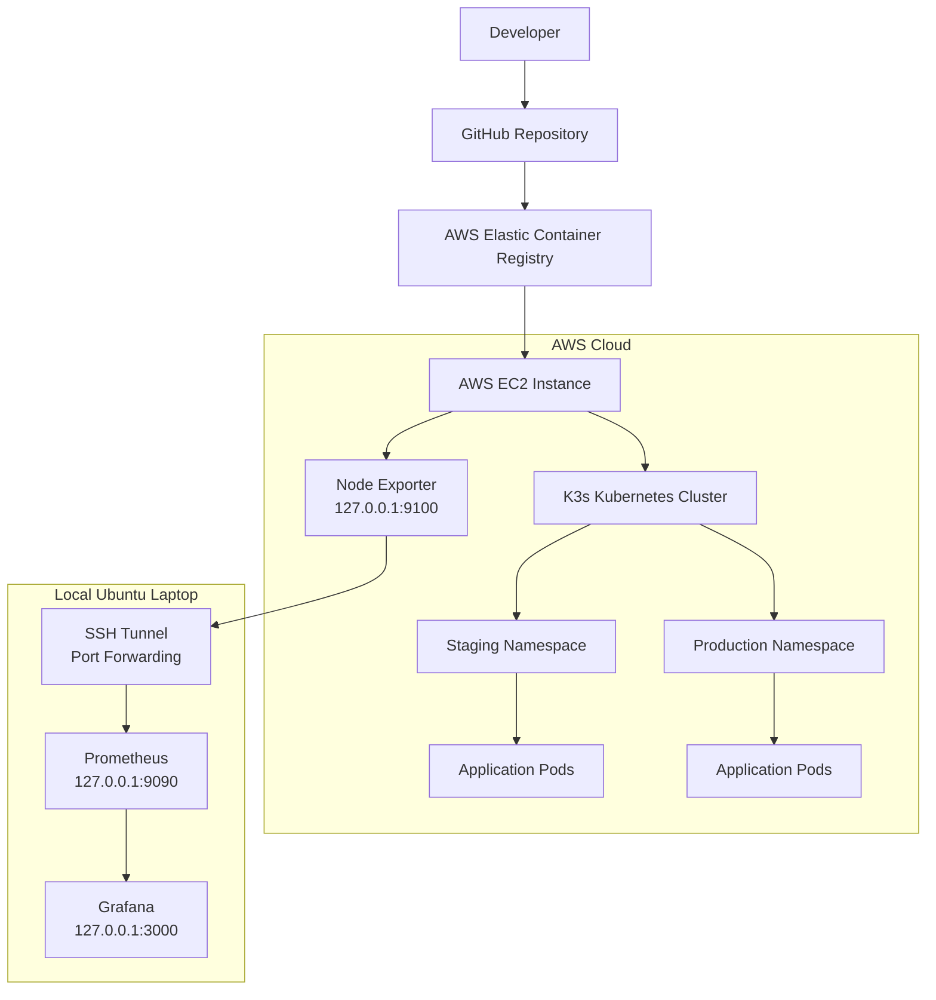
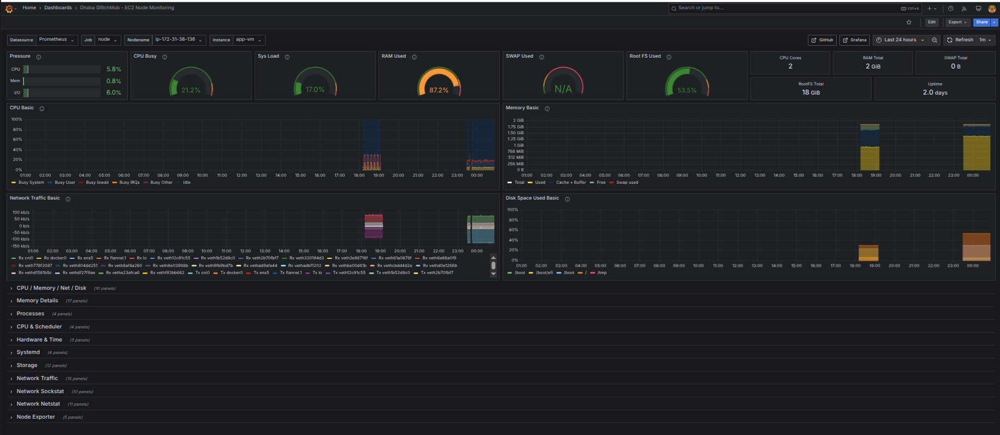

# Dhaba Orders — The Glitch Mob

A containerized restaurant ordering application deployed on Kubernetes using AWS EC2 and K3s, with infrastructure monitoring through Prometheus, Node Exporter, and Grafana.

Developed as part of **ShipIt Sprint 3: Production on Kubernetes**.

## Team

- **Sidrah** — Team Lead, CI/CD and Deployment
- **Amir** — Application Development and Docker
- **Haroon** — Kubernetes and Infrastructure

## Project Overview

Dhaba GlitchMob is a restaurant ordering application with a web frontend, backend APIs, kitchen services, databases, and supporting infrastructure.

The project focuses on deploying and managing containerized workloads using Kubernetes, maintaining separate staging and production environments, and monitoring infrastructure performance.

## Technology Stack

- React and Vite
- Python and FastAPI
- Go
- Java and Spring Boot
- PHP and Laravel
- PostgreSQL and Redis
- Docker
- Kubernetes and K3s
- AWS EC2 and AWS ECR
- Prometheus, Grafana, and Node Exporter
- Git and GitHub

## Deployment Architecture

The application runs on an AWS EC2 instance using K3s Kubernetes.

Separate Kubernetes namespaces are maintained for staging and production to isolate application workloads.

See [Architecture Documentation](docs/architecture/README.md).

### Architecture Diagram

Editable source: [architecture.mmd](docs/architecture/architecture.mmd).

## Infrastructure Monitoring

Infrastructure monitoring uses three main components:

- **Node Exporter:** Collects Linux system metrics from the EC2 instance.
- **Prometheus:** Collects and stores metrics.
- **Grafana:** Provides interactive dashboards for infrastructure visualization.

Prometheus and Grafana run on the local Ubuntu laptop. An SSH tunnel securely forwards metrics from the EC2 instance to the local monitoring environment.

### Grafana Dashboard

The dashboard provides visibility into:

- CPU utilization
- Memory utilization
- Root disk usage
- Network traffic
- System load
- Operating system and system-level metrics

## Security Considerations

- Node Exporter listens only on the EC2 loopback interface.
- Port 9100 is not publicly exposed.
- SSH tunneling provides secure access to monitoring metrics.
- Staging and production workloads are separated using Kubernetes namespaces.

## Project Documentation

- [System Architecture](docs/architecture/README.md)
- [Architecture Diagram Source](docs/architecture/architecture.mmd)
- [Grafana Monitoring Screenshot](docs/screenshots/grafana-ec2-monitoring.png)

## Project Status

Completed work includes:

- Frontend redesign and staging deployment.
- Version-controlled staging deployment configuration.
- Node Exporter installation on EC2.
- Prometheus metrics collection.
- Grafana monitoring dashboard.
- Architecture and monitoring documentation.

Further work includes alerting, CI/CD automation, and deployment automation.
